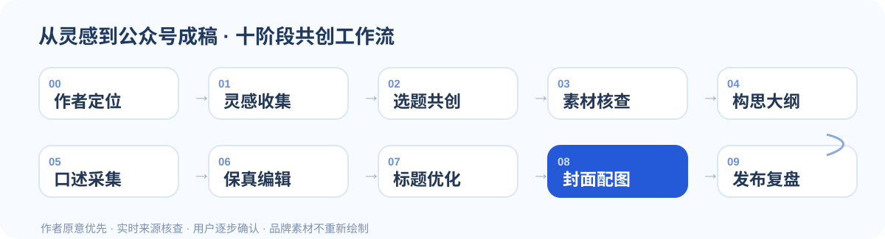

<sub>🌐 <b>中文</b> · <a href="README.en.md">English</a></sub>

<div align="center">

# xiaokangxxs-wechat-writer

> **把自己的话写明白，再把文章做成真正能发布的公众号图文。**

[](VERSION)
[](LICENSE)
[](SKILL.md)
[](docs/USAGE.md)
[](https://github.com/xiaokangxxs/xiaokangxxs-wechat-writer/actions/workflows/validate.yml)

**选题 → 资料 → 大纲 → 口述 → 保真编辑 → 标题 → 公众号封面与配图 → 发布检查**

```bash
npx skills add xiaokangxxs/xiaokangxxs-wechat-writer
```

[30 秒上手](#30-秒上手) · [效果预览](#效果预览) · [写作流程](#十阶段协作流程) · [品牌形象](#品牌与手绘风格) · [安装](docs/INSTALL.md) · [常见问题](docs/FAQ.md)

</div>

<p align="center"></p>

---

## 效果预览

这是**演示用文章**，并非作者已确认的真实口述经历或已发布的公众号文章。

**测试文章：《AI 工具越用越多，为什么事情反而没做完？》**

| 公众号文章封面 | 文章核心观点可视化 |
| :---: | :---: |
|  |  |
| 默认品牌与手绘排版方向 | AI 生成快 ≠ 最终交付快 |

<p align="center"></p>

> **图示说明：**仓库里的 SVG 是用于展示版式和视觉规则的可浏览测试示意图；原版高清 PNG、3D 人物素材以及离线 HTML 样稿见本项目的原始完整本地交付包。SVG 不冒充 AI 实际生成的 PNG 图。尚未完成真实公众号后台发布测试。

[阅读测试文章](examples/demo-article.md) · [五组标题及出图方案](examples/demo-publish-pack.md) · [测试与验收](tests/README.md) · [视觉规范](docs/VISUAL_GUIDE.md)

---

## 它能做什么

| 能力 | 具体输出 |
|---|---|
| 选题共创 | 热点 / 非热点两条线路，挖掘独特角度，不制造伪反常识 |
| 素材检索 | 对授权可访问的知识库、网页、笔记、旧文进行检索与来源标记 |
| 逐步写作 | 默认严格按阶段确认，不擅自跳过用户决策 |
| 口述与草稿 | 接收语音转写、零散素材或完整稿件 |
| L1 / L2 / L3 编辑 | 默认保真整理；深度润色和扩写必须明确授权 |
| 事实与版权检查 | 区分个人观点、亲历和公开事实，不造数据、不盗图 |
| 5 种标题 | 反常识、数字、情绪、悬念、观点，25 字以内并与正文一致 |
| 公众号排版 | 标题、摘要、清爽段落、可复制 Markdown / 本地 HTML |
| 手绘视觉引擎 | 参考 [yang0/handraw-style](https://github.com/yang0/handraw-style)，支持编号优先 / 文章主题动态推荐 |
| 品牌适配 | 「小康新鲜事儿」品牌规则，支持自行替换 3D 人物 / Logo / 公众号名 |
| 正文配图 | 在认知转折处规划 0–4 张图；提供锚点、alt 文本和出图提示词 |
| 发布质检 | 手机端裁切、安全区、图文连贯、版权、隐私、真实性检查 |

## 十阶段协作流程

```text
作者档案（可跳过）
     ↓
灵感收集 → 选题共创 → 授权素材检索
     ↓
作者大纲 → 口述/草稿 → 保真编辑（L1 默认）
     ↓
文章质检 → 五组标题 → 品牌封面 / 适当正文配图
     ↓
公众号发布清单 → 复盘沉淀（经用户授权）
```

默认先问“你有没有已经想写的选题或灵感”，每个关键节点等待确认；明确要求演示时才用标注为示例的输入跑通完整流程。详见 [SKILL.md](SKILL.md)、[工作流说明](docs/ARCHITECTURE.md)。

## 品牌与手绘风格

本项目默认公众号：**小康新鲜事儿**。封面需要体现该品牌的 **3D 形象、真实 Logo 与公众号名**；其他用户可上传自己的素材，且不能混用两个品牌。优先使用品牌原始素材叠加，禁止让生图工具重画 Logo。素材的实际使用以品牌包是否已提供、是否有授权为前提。

手绘画风来自独立上游项目 **yang0/handraw-style**，版权与署名要求见 [ATTRIBUTION.md](ATTRIBUTION.md)。支持用户输入 **169 / FH-015** 等编号，也可根据文章核心隐喻智能推荐。风格编号、版式编号、主题色是不同维度，不能混淆。

- **封面**：默认 2.35:1；一个核心视觉隐喻、少量标题字、清晰品牌元素、移动端裁切安全区。
- **正文**：0–4 张为宜；长文优先 4:3；必须解释具体段落，不因字数自动塞图。
- **样式**：拒绝乱堆机器人、对话框、霓虹科技装饰。更多见 [视觉指南](docs/VISUAL_GUIDE.md)。

## 30 秒上手

### 1. 安装

```bash
npx skills add xiaokangxxs/xiaokangxxs-wechat-writer
```

这是通过 Skills CLI 读取 GitHub 仓库，不是 npm 包发布。也可以使用：

```bash
git clone https://github.com/xiaokangxxs/xiaokangxxs-wechat-writer.git
```

按 Agent 的 Skills 加载目录放置整个项目。详细操作见 [docs/INSTALL.md](docs/INSTALL.md)。

### 2. 对话触发

```text
使用 xiaokangxxs-wechat-writer，
按步骤和我共创一篇公众号文章。
默认使用小康新鲜事儿品牌，封面采用 handraw 风格，
正文在真正需要解释的地方配图。
```

也可以：

```text
使用这个 Skill，按 L1 保真整理我的口述稿，别添加新经历。
```

```text
给文章《……》做封面，指定 handraw-style 的 169 号风格；
Logo 必须使用我提供的原始素材。
```

### 3. 验证

```bash
python scripts/validate_skill.py .
python -m unittest discover -s tests -p 'test_*.py'
```

只做规则阅读、Markdown 和基础校验不需要外部 API 或付费生图账户。真正**自动生成图片**依赖使用环境支持的生图工具；不要把“提示词生成”说成“图片已生成”。

## 文件结构

```text
xiaokangxxs-wechat-writer/
├── SKILL.md
├── README.md / README.en.md
├── VERSION / CHANGELOG.md / LICENSE / ATTRIBUTION.md
├── SECURITY.md / CONTRIBUTING.md / CITATION.cff
├── references/             # 写作、核查、品牌、手绘、排版
├── assets/
│   ├── readme/             # GitHub 首页测试图（SVG）
│   └── *.template.md       # 作者档案、文章、封面、配图
├── scripts/                # 校验与本地 HTML 演示
├── examples/               # 测试文章、发布包、图文效果
├── tests/                  # 自动测试、验收矩阵
├── docs/                   # 安装、架构、教程、FAQ、安全
└── .github/workflows/      # GitHub Actions CI
```

## 文档导航

[安装指南](docs/INSTALL.md) · [使用手册](docs/USAGE.md) · [技术架构](docs/ARCHITECTURE.md) · [视觉与品牌规范](docs/VISUAL_GUIDE.md) · [示例文章](examples/demo-article.md) · [测试方法](tests/README.md) · [FAQ](docs/FAQ.md) · [安全说明](SECURITY.md) · [贡献指南](CONTRIBUTING.md) · [版本记录](CHANGELOG.md)

## 安全、版权与开源

- 核心写作规则与本仓库自有代码使用 **MIT License**。
- 第三方 handraw-style 内容遵循其自己的许可证和**保留原作者 yang0 与仓库地址**的署名要求；本仓库不是其官方发行版本。
- **个人 3D 人物、Logo、头像及公众号品牌资产不属于 MIT 授权范围**。公众仓库中不应把这些个人资产当作可自由商用的素材；如提供或引用，应明确权属。
- 本 Skill 不自动发布到微信，不会自行登录你的公众号，也不上传用户笔记、品牌素材到作者服务器。
- 实测示例与真实用户文章明确区分，不造新闻来源、不伪造文章阅读数据。

详细见 [SECURITY.md](SECURITY.md) 与 [ATTRIBUTION.md](ATTRIBUTION.md)。

---

<p align="center"><b>让 AI 帮你写好自己的文章，不是写一篇像所有人的文章。</b></p>
